# Distortion

**An open-source Material You music player for Android that works with your Spotify account.** Browse your mixes, swipe the mini player open, and follow along with synchronized lyrics.

[](https://apps.obtainium.imranr.dev/redirect?r=obtainium://app/%7B%22id%22%3A%22app.distortion.music%22%2C%22url%22%3A%22https%3A%2F%2Fgithub.com%2Fdroid2299%2FDistortion-Android%22%2C%22author%22%3A%22droid2299%22%2C%22name%22%3A%22Distortion%22%2C%22additionalSettings%22%3A%22%7B%5C%22apkFilterRegEx%5C%22%3A%5C%22%5EDistortion-%5B0-9%5D%2B%5C%5C%5C%5C.%5B0-9%5D%2B%5C%5C%5C%5C.%5B0-9%5D%2B-universal%5C%5C%5C%5C.apk%24%5C%22%2C%5C%22autoApkFilterByArch%5C%22%3Afalse%2C%5C%22includePrereleases%5C%22%3Afalse%7D%22%7D)

[All downloads](https://github.com/droid2299/Distortion-Android/releases/latest) · [User guide](docs/USER-GUIDE.md) · [Changelog](CHANGELOG.md) · [Report an issue](https://github.com/droid2299/Distortion-Android/issues/new)

## Screenshots

### Browse

| Home | New | Radio |
| :---: | :---: | :---: |
| 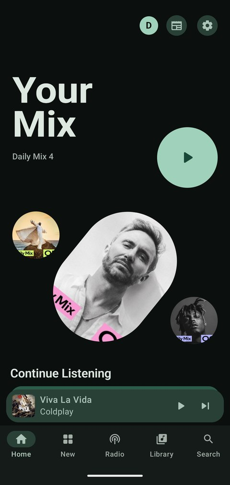 | 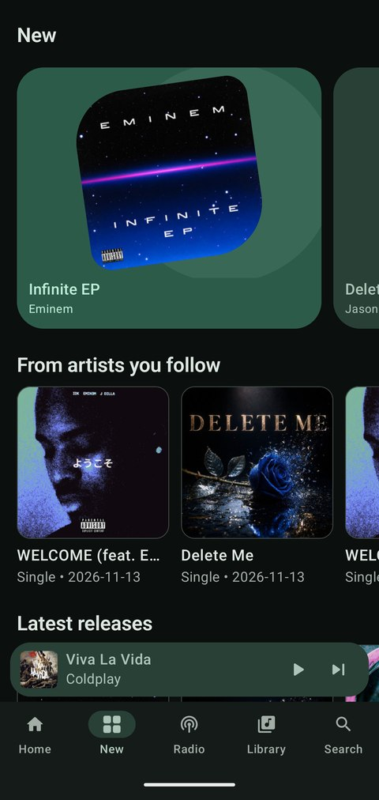 | 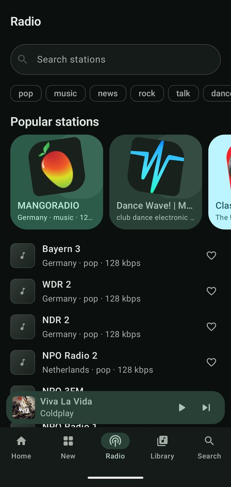 |

| Library | Search |
| :---: | :---: |
| 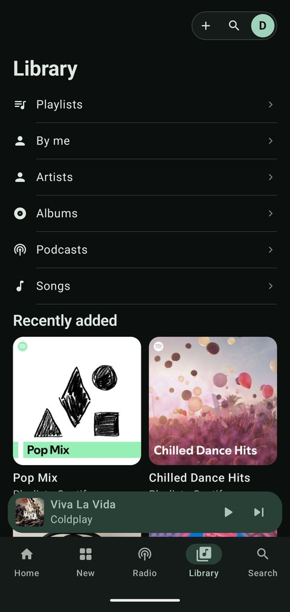 | 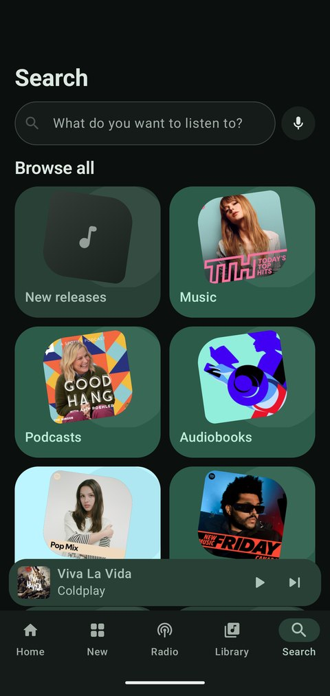 |

### Playback

| Now Playing | Lyrics | Queue |
| :---: | :---: | :---: |
| 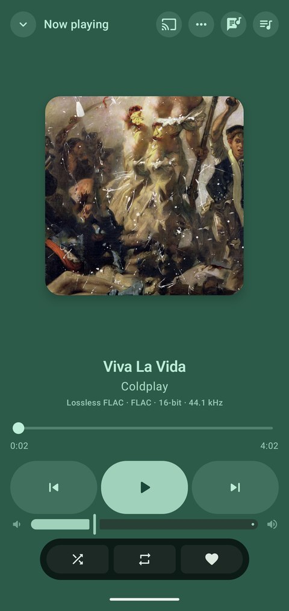 | 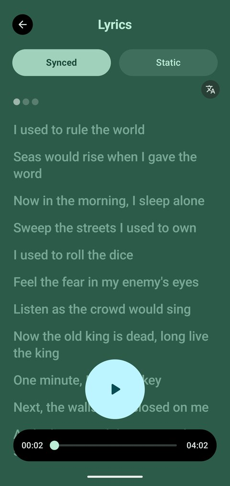 | 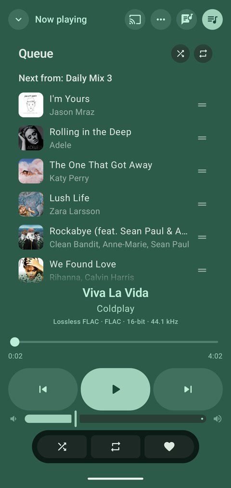 |

### Detail pages and settings

| Artist | Album | Playlist |
| :---: | :---: | :---: |
| 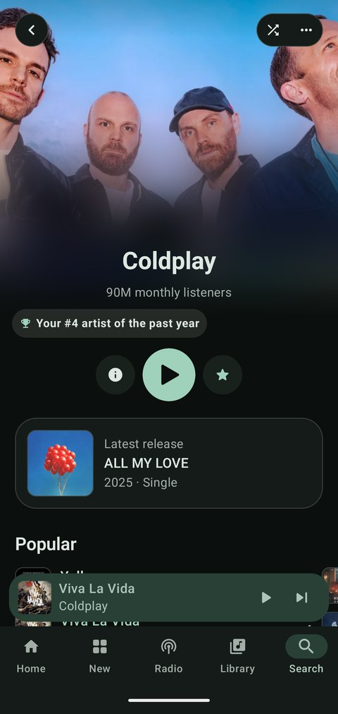 | 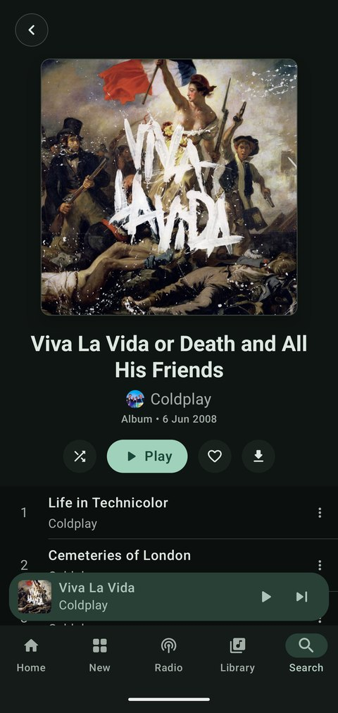 | 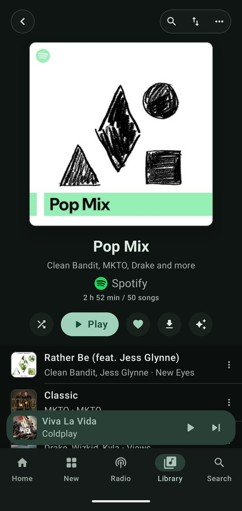 |

| Settings | Extensions | Download settings |
| :---: | :---: | :---: |
| 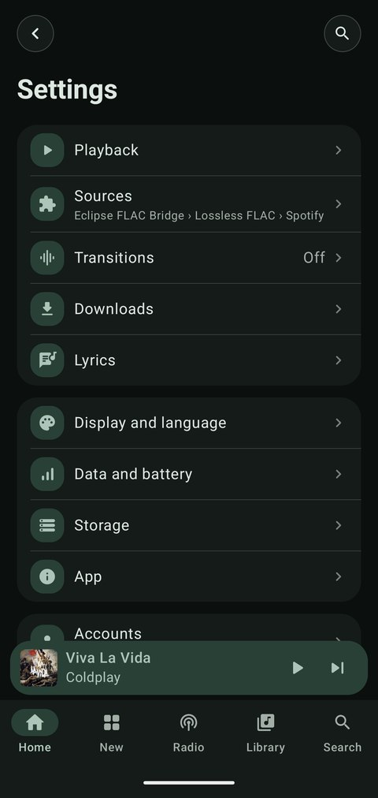 | 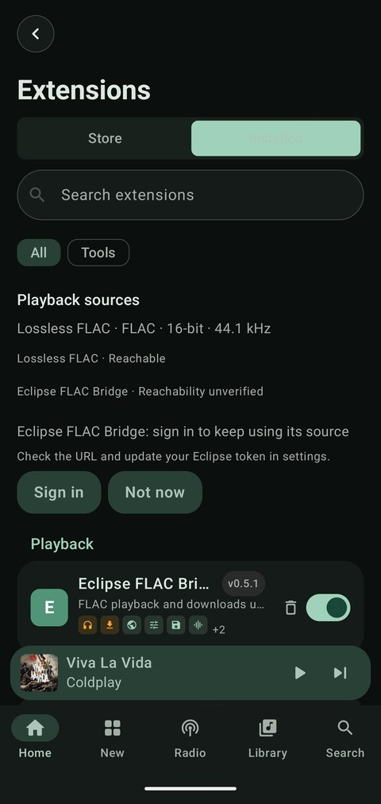 | 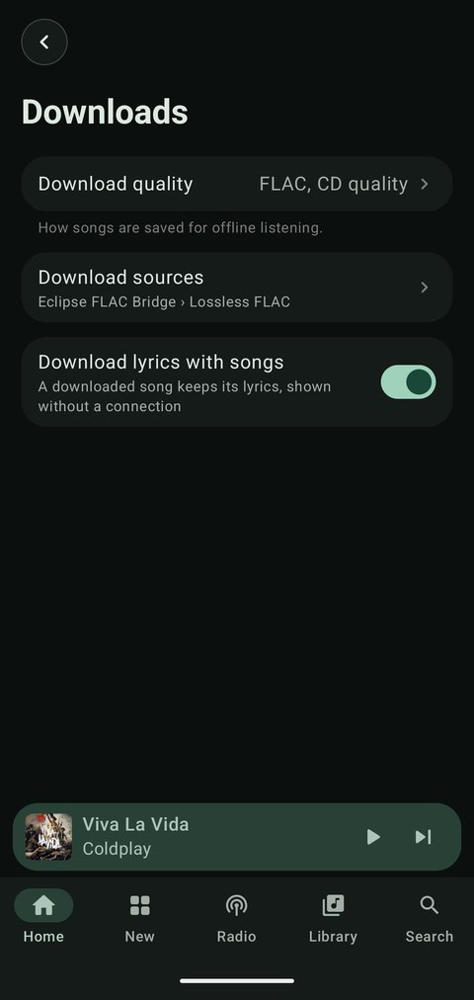 |

## Install

Distortion requires Android 10 or later and a Spotify account. Use **Download for Android** for most recent phones, or choose another APK under **Assets** in the latest release. **Add to Obtainium** tracks stable releases and selects the universal APK, which supports both ARM architectures.

| Device | APK suffix |
| --- | --- |
| Modern 64-bit Android phone or tablet, including recent Pixels | `-ARMv8.apk` |
| 32-bit ARM Android device | `-ARMv7.apk` |
| Android TV or Google TV | `-TV.apk` |
| Unsure which ARM version you have | `-universal.apk` |

Open the APK on your device. If Android asks, allow your browser or Files app to install it. To update an existing Distortion release, install the new APK over it to retain your app data. [Installation and update help](docs/USER-GUIDE.md#install-and-update)

## What you can do

- **Find music.** Home includes Your Mix, Continue Listening, and Recently Played. New, Radio, Library, and Search have their own tabs.
- **Control playback.** Swipe across the cover to change tracks, swipe up on the mini player to expand it, and swipe down to collapse it. Now Playing includes a wavy seek bar, synchronized lyrics, and queue controls.
- **Match your system theme.** The Material You interface and home-screen widget follow Android's colors.
- **Add playback sources.** Compatible extensions can provide alternative audio, downloads, or lyrics. Source and quality information reflects what the active source reports. [Extension user guide](docs/extensions/GUIDE.md)

Spotify playback uses Spotify's Web Player inside Distortion. Built-in audio processing such as AutoMix and the equalizer applies to eligible extension, downloaded, and device audio. [Playback and troubleshooting](docs/USER-GUIDE.md#playback-sources)

## Documentation

| I want to | Start here |
| --- | --- |
| Set up, update, or troubleshoot the app | [User guide](docs/USER-GUIDE.md) |
| Install or troubleshoot an extension | [Extension guide](docs/extensions/GUIDE.md) |
| Develop a compatible extension | [Extension API](docs/extensions/API.md) |
| Build, test, or understand the app | [Developer guide](docs/DEVELOPMENT.md) |
| Contribute a fix, translation, or bug report | [Contributing](CONTRIBUTING.md) |
| Build and publish a signed release | [Release guide](docs/RELEASING.md) |

## License and credits

Distortion is distributed under the [GNU General Public License v3.0](LICENSE.md). It is derived from [Myspoti](https://github.com/kota-zo/myspoti). The Immersive look and parts of the audio and UI work draw on [BitChord](https://github.com/kushagrasinghx/BitChord). [Full upstream and third-party notices](THIRD_PARTY_NOTICES.md)

Additional project credits include [Spotui](https://github.com/Spotui/Spotui) and [Metrolist](https://github.com/MetrolistGroup/Metrolist) for UI lineage, [NewPipeExtractor](https://github.com/TeamNewPipe/NewPipeExtractor) for music videos, and [Reorderable](https://github.com/Calvin-LL/Reorderable) for queue drag controls. The app uses Material Icons and fonts including Manrope, with their [license texts](base/licenses).
